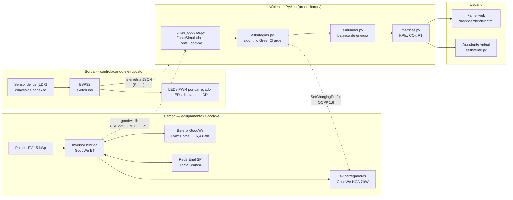
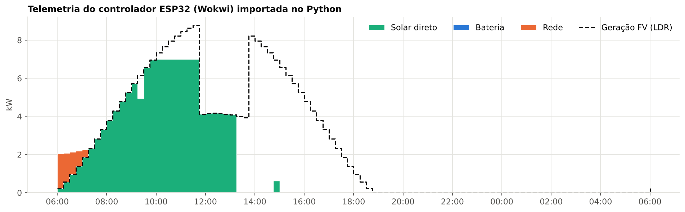
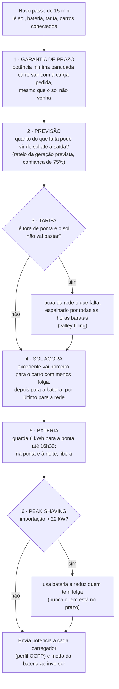
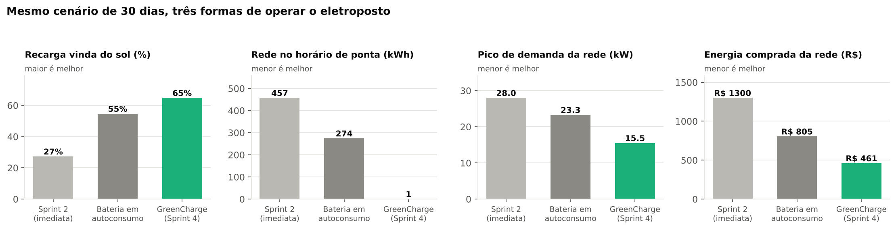
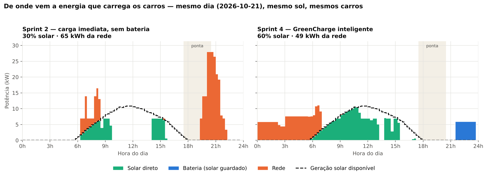
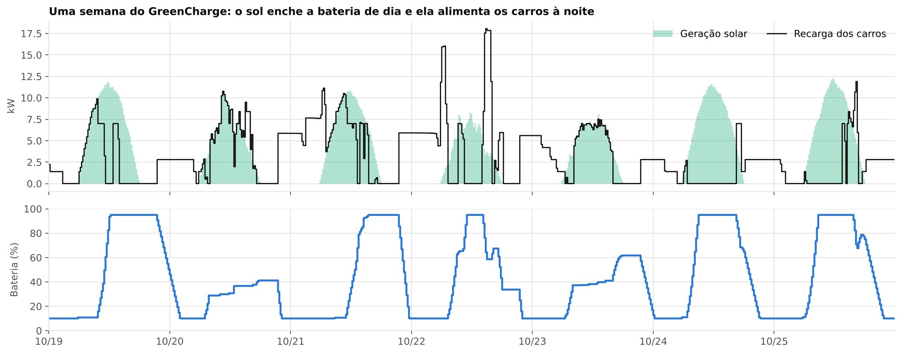
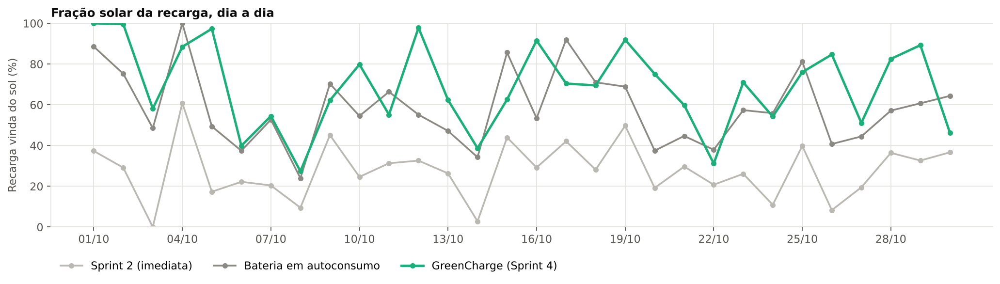

# GreenCharge — Sprint 4: Solução Final Integrada

**Gestão inteligente de eletropostos com energia solar, bateria e recarga programada**

EV Challenge 2026 · GoodWe Brasil · FIAP — Ciência da Computação · Disciplina: Energias Renováveis e Sustentabilidade · Turma 1CCPY

| Integrante | RM |
|---|---|
| Bryan Lugli | RM571350 |
| Beckman Lugli | RM573442 |
| Guilherme Xavier | RM573053 |

🎥 **Vídeo de demonstração:** _(link do YouTube não listado)_
📦 **Sprints anteriores:** [Sprint 2 — simulação](https://github.com/BryanLugli/EV-Challenge-Energias-sustentaveis-02) · [Sprint 3 — protótipo ESP32](https://github.com/BryanLugli/EV-Challenge-Energias-sustentaveis-03)

---

## Sumário

1. [Resumo em 30 segundos](#1-resumo-em-30-segundos)
2. [O problema e como a solução evoluiu](#2-o-problema-e-como-a-solução-evoluiu)
3. [Arquitetura final e integração dos sistemas](#3-arquitetura-final-e-integração-dos-sistemas)
4. [O algoritmo inteligente](#4-o-algoritmo-inteligente)
5. [Resultados quantitativos](#5-resultados-quantitativos)
6. [Resultados qualitativos](#6-resultados-qualitativos)
7. [Alinhamento ao desafio GoodWe e à disciplina](#7-alinhamento-ao-desafio-goodwe-e-à-disciplina)
8. [Avaliação crítica: sustentabilidade, inovação e limitações](#8-avaliação-crítica-sustentabilidade-inovação-e-limitações)
9. [Como executar](#9-como-executar)
10. [Estrutura do repositório](#10-estrutura-do-repositório)
11. [Tecnologias, sensores e referências](#11-tecnologias-sensores-e-referências)

---

## 1. Resumo em 30 segundos

O GreenCharge é o "cérebro" de um eletroposto com painéis solares, inversor híbrido GoodWe ET, bateria GoodWe Lynx Home F e carregadores GoodWe HCA. A cada 15 minutos ele olha o sol (medido e previsto), a bateria, a tarifa do horário e o prazo de cada carro, e decide **quanto cada carregador puxa e de onde vem essa energia**.

No mesmo cenário de 30 dias (mesmo sol, mesmos 229 carros), comparado com a lógica da nossa Sprint 2:

| | Sprint 2 | **GreenCharge (Sprint 4)** |
|---|---|---|
| Recarga vinda do sol | 27% | **65%** |
| Energia da rede no horário de ponta | 457 kWh | **0,7 kWh** |
| Pico de demanda da rede | 28,0 kW (estoura o limite de 22 kW) | **15,5 kW** |
| Compra da rede por kWh entregue | R$ 0,735 | **R$ 0,236 (−68%)** |
| Recargas concluídas | 82,7% | **92,9%** |

Projeção de um ano inteiro: **57% da recarga vinda do sol** (Sprint 2: 25%), **R$ 9 mil a menos** de energia comprada da rede e **26,4 t de CO₂ evitadas** em relação a carros a gasolina.

Tudo isso aparece funcionando em quatro peças integradas: o **motor de simulação e decisão em Python**, o **painel web**, o **assistente virtual** e o **controlador embarcado ESP32** no Wokwi, que roda o mesmo algoritmo lendo sensores e manda telemetria de volta para o Python.

---

## 2. O problema e como a solução evoluiu

Eletropostos costumam puxar energia da rede mesmo com painel solar ao lado, e quase sempre no pior horário: as pessoas chegam em casa entre 18h e 20h, que é a ponta da Tarifa Branca (R$ 1,48/kWh na Enel SP, mais que o dobro do fora de ponta) e o momento em que o sistema elétrico mais aciona térmicas.

| Sprint | O que tínhamos | O que faltava |
|---|---|---|
| 1 | Ideia e arquitetura | — |
| 2 | Simulação em Python, 30 dias × 24 h, regra "solar primeiro" | A regra só **contava** quanto do sol era usado. Cada carro puxava potência máxima assim que chegava; o sistema não mudava nenhum comportamento. |
| 3 | Protótipo ESP32 no Wokwi com 6 cenários fixos e LEDs | Os dados eram fixos (sem sensores) e a decisão era a mesma da Sprint 2. Revendo os cenários, notamos que o caso "12h, 4,6 kW de sol, 2 carros" foi descrito como 100% solar, mas pela própria regra a demanda era 14,8 kW, então era misto. Isso mostrou o limite da abordagem: **sem modular a potência, quase nunca dá para carregar 100% com sol**. |
| **4** | **Solução integrada** | Esta entrega. |

O que a Sprint 4 acrescenta:

1. **Armazenamento** — bateria GoodWe Lynx Home F (16,38 kWh, LFP) gerida pelo inversor híbrido GoodWe ET.
2. **Recarga modulada** — o carregador não é mais liga/desliga: a potência varia de 1,4 a 7 kW, seguindo o sol (é o que o GoodWe HCA faz no modo de excedente solar, e o que o padrão OCPP permite comandar).
3. **Prazo de cada carro** — cada sessão tem chegada, saída prevista e kWh pedidos. Quem tem folga espera o sol; quem tem pressa é atendido.
4. **Previsão solar e tarifa** — o algoritmo usa a previsão do dia e a Tarifa Branca real da Enel SP (vigente desde 04/07/2026).
5. **Peak shaving** — nunca passa do limite contratado com a rede.
6. **Gestão de fila** — o app avisa o motorista quando a carga termina e a vaga é liberada para o próximo.
7. **Painel web, assistente virtual e telemetria do controlador embarcado.**

---

## 3. Arquitetura final e integração dos sistemas

### 3.1 Visão geral



### 3.2 Como as peças conversam

| Ligação | Na POC (esta entrega) | Em produção |
|---|---|---|
| Geração FV e bateria → núcleo | `FonteSimulada`: modelo de céu claro de Haurwitz + clima por cadeia de Markov | `FonteGoodWe`: lê `ppv` (potência FV) e `battery_soc` do inversor pela biblioteca open-source `goodwe` (UDP 8899 ou Modbus/TCP 502) |
| Núcleo → carregadores | A decisão vira potência por carregador no simulador | `comando_ocpp()` gera o `SetChargingProfile` (limite em A) do OCPP 1.6, enviado ao GoodWe HCA ou a qualquer carregador OCPP |
| Núcleo → bateria | A estratégia informa quanto a bateria pode descarregar | Modo de trabalho do inversor ET (autoconsumo / reserva) |
| Controlador ESP32 → núcleo | Telemetria JSON no Monitor Serial do Wokwi, importada por `importar_wokwi.py` | MQTT ou HTTP pelo Wi-Fi do ESP32 |
| Núcleo → usuário | `dashboard/index.html` e `assistente.py` | Mesmo painel servido na web; assistente no app/WhatsApp |

A troca entre simulação e equipamento real é uma linha: o algoritmo só recebe `pv_kw` e `soc_kwh`, não importa de onde venham.

### 3.3 Controlador embarcado (ESP32 no Wokwi)

O protótipo da Sprint 3 rodava 6 cenários fixos. Agora ele **lê sensores e roda o mesmo algoritmo do Python** em C++:

| Componente | Pino | Papel |
|---|---|---|
| Sensor de luminosidade (LDR) | D34 (AO) | Claridade do céu → geração FV. 100 lux = tempestade, 100.000 lux = sol pleno |
| Chave deslizante "Carro 1" | D32 | Carro conectado no carregador 1 (pede 22 kWh, fica 9 h) |
| Chave deslizante "Carro 2" | D33 | Carro conectado no carregador 2 (pede 12 kWh, fica 4 h) |
| LED branco EV1 / EV2 (PWM) | D18 / D19 | Brilho = potência liberada ao carro (o limite de corrente OCPP) |
| LED verde / amarelo / vermelho | D25 / D26 / D27 | Recarga só solar / mista / só rede |
| LED azul | D14 | Bateria descarregando para os carros |
| LCD 16×2 I2C | D21 (SDA) / D22 (SCL) | Hora, posto tarifário, geração, bateria e potência de cada carro |

O relógio é acelerado (1,5 s real = 15 min), então um dia inteiro passa em cerca de 2,5 minutos e dá para mostrar no vídeo o sol nascendo, a bateria enchendo, a ponta chegando e os carros sendo atendidos. A cada passo o ESP32 imprime uma linha JSON com **as mesmas colunas do simulador Python** (`pv_para_ev_kw`, `bateria_para_ev_kw`, `rede_para_ev_kw`…), e `python -m greencharge.importar_wokwi log.txt` transforma isso em resumo e gráfico:



_O gráfico acima vem de `firmware/exemplo_log_serial.txt`, gerado executando a lógica do `sketch.ino` no computador (compilado com g++ e substitutos das bibliotecas do Arduino). Com o log real do Monitor Serial do Wokwi o comando é o mesmo. Repare às 11h45: uma nuvem derruba a geração para 4 kW e a potência do carro cai junto, sem puxar da rede._

---

## 4. O algoritmo inteligente

A cada 15 minutos (`greencharge/estrategias.py`, função `greencharge`):



**Por que funciona.** A maior parte da energia de recarga é flexível no tempo: quem trabalha no prédio fica 7 a 10 horas e precisa de 5 a 12 kWh; quem mora chega às 19h e só sai às 7h. A regra da Sprint 2 desperdiçava essa flexibilidade carregando tudo na hora da chegada. O GreenCharge move a carga para quando há sol (dia) ou tarifa barata (depois das 21h30) e usa a bateria para cobrir o que sobra à noite.

**As três estratégias comparadas** (mesmo sol, mesmos carros, mesma física):

| Estratégia | O que faz |
|---|---|
| `imediata` | Lógica da Sprint 2: carrega a 7 kW assim que o carro chega; usa o sol que estiver disponível. Sem bateria. |
| `autoconsumo` | Mesma recarga imediata, mas com a bateria GoodWe no modo de fábrica (guarda o excedente e descarrega sempre que falta). Mostra o que o **hardware sozinho** entrega, sem software de gestão. |
| `greencharge` | O algoritmo acima + gestão de fila. |

O simulador (`simulador.py`) é quem garante a física: nenhuma energia surge do nada, a bateria respeita limites de carga (10–95%), potência (7,5 kW) e eficiência de ida e volta (92%), e só carrega com sol. Isso é verificado automaticamente pelos testes (`tests/`).

---

## 5. Resultados quantitativos

### 5.1 Cenário

| Item | Valor |
|---|---|
| Período | 01/10 a 30/10/2026, passos de 15 min (2.880 passos) |
| Clima simulado | 18 dias de sol, 10 parcialmente nublados, 2 nublados |
| Geração FV no período | 2.225 kWh (15 kWp) |
| Sessões de recarga | 229 (trabalhadores de dia, moradores à noite, visitas rápidas) |
| Tarifa | Tarifa Branca B1 Enel SP: ponta R$ 1,48 · intermediário R$ 0,98 · fora de ponta R$ 0,67 (TUSD+TE, sem impostos) |

### 5.2 Comparação — 30 dias



| Indicador | Sprint 2 (imediata) | Bateria em autoconsumo | **GreenCharge** |
|---|---:|---:|---:|
| Recarga vinda do sol | 27,3% | 54,7% | **64,8%** |
| Autoconsumo da geração FV | 21,7% | 45,1% | **57,9%** |
| Energia entregue aos carros | 1.768 kWh | 1.768 kWh | **1.953 kWh** |
| Energia da rede | 1.285 kWh | 801 kWh | **688 kWh** |
| Rede no horário de ponta | 457,4 kWh | 274,5 kWh | **0,7 kWh** |
| Pico de demanda da rede | 28,0 kW | 23,3 kW | **15,5 kW** |
| Intervalos de 15 min acima do limite de 22 kW | 8 | 1 | **0** |
| Compra de energia da rede | R$ 1.300,02 | R$ 805,27 | **R$ 461,13** |
| Compra da rede por kWh entregue | R$ 0,735 | R$ 0,455 | **R$ 0,236** |
| Recargas concluídas com a carga pedida | 82,7% | 82,7% | **92,9%** |
| CO₂ emitido pela recarga (fator do SIN) | 31,7 kg | 19,8 kg | **17,0 kg** |

### 5.3 Um dia lado a lado



Este gráfico resume a diferença. À esquerda (Sprint 2), os moradores chegam no fim da tarde e o eletroposto puxa **28 kW da rede justo na ponta**, acima do limite contratado. À direita, o GreenCharge deixa a ponta vazia, carrega os moradores depois das 21h30 com a energia solar guardada na bateria (azul) e completa de madrugada com tarifa barata; durante o dia a recarga acompanha a curva do sol.

### 5.4 A bateria trabalhando



A bateria enche no fim da manhã com o excedente solar e descarrega à noite alimentando os carros. Em dias parcialmente nublados (22 e 23/10) ela não chega a encher, e o algoritmo compensa puxando da rede no fora de ponta.



### 5.5 O que cada parte contribui (análise de ablação)

Para não misturar efeitos, rodamos também o GreenCharge **sem** a gestão de fila:

| | Sprint 2 | + bateria | + algoritmo | + gestão de fila |
|---|---:|---:|---:|---:|
| Recarga vinda do sol | 27,3% | 54,7% | 65,6% | 64,8% |
| Rede na ponta | 457 kWh | 275 kWh | 5,6 kWh | 0,7 kWh |
| Pico da rede | 28,0 kW | 23,3 kW | 14,6 kW | 15,5 kW |
| Rede por kWh entregue | R$ 0,735 | R$ 0,455 | R$ 0,233 | R$ 0,236 |
| Recargas concluídas | 82,7% | 82,7% | 82,7% | 92,9% |

Leitura: **a bateria sozinha dobra a fração solar**, mas continua carregando na ponta e não resolve o pico. **O algoritmo é o que zera a ponta e derruba o pico**, porque decide *quando* carregar. **A gestão de fila** não mexe na energia, mas atende 10 pontos percentuais a mais de motoristas com os mesmos 4 carregadores (mais 185 kWh entregues no mês).

### 5.6 Projeção anual (365 dias, jan–dez/2026)

| | Sprint 2 | **GreenCharge** |
|---|---:|---:|
| Recarga vinda do sol | 24,9% | **57,2%** |
| Energia entregue aos carros | 21.423 kWh | **22.684 kWh** |
| Rede no horário de ponta | 5.251 kWh | **102 kWh** |
| Compra de energia da rede | R$ 15.619 | **R$ 6.591** |
| Pico de demanda da rede | 28,0 kW | **21,6 kW** |
| Km elétricos rodados | 126.020 km | **133.435 km** |
| CO₂ evitado vs. carros a gasolina | 24,8 t | **26,4 t** |
| Gasolina não queimada | 11.456 L | **12.130 L** |
| Ciclos da bateria | — | 221 (LFP tem garantia de 10 anos) |

A fração solar anual (57%) fica abaixo da de outubro (65%) porque o modelo inclui o inverno, com sol mais baixo e dias mais curtos.

---

## 6. Resultados qualitativos

- **Funciona com equipamento que já existe.** Inversor, bateria e carregador são produtos de linha da GoodWe; o GreenCharge é software. A biblioteca `goodwe` usada na integração lê inversores das famílias ET, EH, BT, BH, ES e outras pela rede local.
- **O motorista não perde nada.** Todo carro que consegue vaga sai com a carga pedida, exceto quando isso era fisicamente impossível (ex.: esperou na fila e ficou 15 min conectado). Isso é verificado em teste automático.
- **A distribuidora ganha.** Zerar a importação na ponta e manter o pico em 15,5 kW (contra 28 kW) significa que um prédio pode ter mais carregadores sem reforçar a entrada de energia.
- **Transparência para o usuário.** O painel mostra, dia a dia, de onde veio cada kWh; o assistente responde em português perguntas como "qual o melhor horário para carregar amanhã?" com base na previsão.
- **Mesma lógica em dois lugares.** O algoritmo roda no Python (gestão central) e no ESP32 (controlador local). Se a internet cair, o controlador continua decidindo sozinho.

### Painel web

`dashboard/index.html` abre direto no navegador, sem servidor. Permite escolher a estratégia e o dia, ver a origem da energia e a bateria a cada 15 min, comparar os indicadores e conversar com o assistente.

### Assistente virtual

```
$ python -m greencharge.assistente "qual o melhor horário para carregar amanhã?"
Amanhã o sol deve render mais entre 10:45 e 13:00 (até 9,7 kW). Se puder, deixe o carro
conectado nesse período: a recarga sai praticamente 100% solar. Evite depender da rede
entre 17h30 e 20h30 (ponta da Tarifa Branca, R$ 1,48/kWh).
```

Funciona offline (intenções por palavra-chave, respondendo com os números reais do relatório). Com a variável `GROQ_API_KEY` definida, usa o modelo `openai/gpt-oss-20b` na Groq, o mesmo provedor do nosso chatbot EV ChargeOps da disciplina de IA, sempre ancorado no `relatorio.json`.

---

## 7. Alinhamento ao desafio GoodWe e à disciplina

### 7.1 Por que cada tecnologia GoodWe

| Equipamento | Por que foi escolhido | Como o GreenCharge usa |
|---|---|---|
| **Inversor híbrido GoodWe ET** (ex.: GW15K-ET) | Trifásico, gerencia FV, bateria e rede no mesmo equipamento; é compatível com a Lynx Home F | Fonte de dados (`ppv`, `battery_soc`, `active_power`) e atuador do modo da bateria |
| **Bateria GoodWe Lynx Home F** (5 × 3,27 kWh = 16,38 kWh) | Química LFP (segura, longa vida), módulos empilháveis de 6,5 a 16,4 kWh, garantia de 10 anos, compatível com ET/EH/BT/BH | Desloca energia solar do meio-dia para a noite; reserva para a ponta |
| **Carregador GoodWe HCA 7 kW** | Funciona com qualquer marca de VE, usa excedente solar direto do FV ou da bateria, integra ao SEMS, IP66 | Potência modulada de 1,4 a 7 kW conforme a decisão |
| **SEMS / SolarGo** | Plataforma de monitoramento da GoodWe | A camada de dados que o GreenCharge consome em produção (via `goodwe` local) |

### 7.2 Como cada item resolve um ponto do desafio

| Ponto do desafio | Como a solução resolve | Evidência |
|---|---|---|
| Geração, armazenamento e uso integrados | FV → inversor ET → bateria Lynx → carregadores HCA, num único balanço de energia a cada 15 min | Seções 3 e 5; `simulador.py`; testes de balanço |
| Monitoramento inteligente | Telemetria a cada 15 min no Python e no ESP32, painel web, LCD local | `dashboard/`, `firmware/`, `resultados/historico_*.csv` |
| Algoritmos inteligentes | Escalonamento por prazo (menor folga primeiro), previsão solar, valley filling, peak shaving | Seção 4; ablação na seção 5.5 |
| Automação avançada | Controlador decide sozinho e aciona carregadores e bateria; app libera vaga | `estrategias.py`, `sketch.ino` |
| Interface amigável e visualização | Painel web interativo, gráficos de origem da energia | `dashboard/index.html`, `docs/img/` |
| Integração com assistente virtual | Assistente em português, offline ou com LLM | `assistente.py`, chat no painel |
| Resultados reais ou simulados | Simulação física com dados reais de tarifa e emissão; projeção anual | Seção 5 |

### 7.3 Conexão com os conteúdos da disciplina

| Conceito estudado | Onde aparece no projeto |
|---|---|
| **Radiação solar e geometria sol–Terra** | Declinação, ângulo horário, equação do tempo, correção de longitude e ângulo zenital em `solar.py`; irradiância de céu claro pelo modelo de Haurwitz |
| **Dimensionamento e desempenho FV** | 15 kWp com performance ratio de 0,80 (temperatura, sujeira, cabos, inversor) |
| **Intermitência das renováveis** | Clima por cadeia de Markov (dias de sol, parciais e nublados que se repetem) e nuvens passageiras correlacionadas |
| **Armazenamento de energia** | Bateria LFP com limites de SoC, potência e eficiência de ida e volta; contagem de ciclos |
| **Autoconsumo × injeção (GD, Lei 14.300)** | Autoconsumo FV subiu de 22% para 58%; a energia injetada é valorada abaixo da consumida (desconto do Fio B) |
| **Tarifação horária e resposta da demanda** | Tarifa Branca real da Enel SP; carga deslocada para fora da ponta |
| **Smart grids e qualidade do sistema** | Peak shaving, limite contratado, carga achatada (valley filling) |
| **Emissões e matriz elétrica brasileira** | Fator de emissão do SIN publicado pelo MCTI; comparação com combustão |
| **ODS** | 7, 9, 11 e 13 (seção 8) |

---

## 8. Avaliação crítica: sustentabilidade, inovação e limitações

### 8.1 Benefícios de sustentabilidade

**O maior ganho ambiental é o carro elétrico existir; o GreenCharge garante que ele seja abastecido do jeito mais limpo e barato possível.** Em um ano, o eletroposto alimenta 133 mil km elétricos, evitando 26,4 t de CO₂ e 12 mil litros de gasolina.

Vale ser honesto sobre a escala do ganho do *software*. A matriz elétrica brasileira já é muito limpa: o fator médio do SIN publicado pelo MCTI ficou entre 0,022 e 0,029 tCO₂/MWh no início de 2025. Por isso, a redução de CO₂ **por trocar rede por sol** é pequena em números absolutos (de 31,7 para 17,0 kg no mês, −46%). Usamos esse fator conservador de propósito; a Sprint 2 usava 0,0897 kg/kWh, sem fonte atual verificável, e corrigimos.

O ganho de sustentabilidade do GreenCharge está em três pontos mais relevantes que o fator médio:

1. **Tirar carga da ponta.** É no fim da tarde que o ONS despacha termelétricas para cobrir a demanda e a queda do solar. O GreenCharge reduz a recarga na ponta de 457 kWh para 0,7 kWh no mês; a emissão marginal evitada nesse horário é maior que a média (não modelamos o fator horário, então esse ganho não está nos números acima).
2. **Usar a energia solar no próprio local.** O autoconsumo FV vai de 22% para 58%. Isso reduz perdas na rede e a necessidade de reforço de transmissão e distribuição.
3. **Mais carros elétricos com a mesma infraestrutura.** Pico de 15,5 kW em vez de 28 kW significa que o mesmo padrão de entrada suporta mais carregadores, removendo uma barreira real à eletrificação em condomínios.

| ODS | Contribuição concreta |
|---|---|
| 7 — Energia limpa e acessível | 65% da recarga com energia solar; custo de compra da rede por kWh 68% menor |
| 9 — Indústria, inovação e infraestrutura | Software sobre hardware GoodWe existente; mais carregadores sem reforço da rede |
| 11 — Cidades sustentáveis | Mobilidade elétrica viável em condomínios |
| 13 — Ação contra a mudança do clima | 26,4 t CO₂/ano evitadas vs. gasolina; carga fora da ponta térmica |

### 8.2 Inovação

- **Escalonamento por prazo com previsão.** Não é só "usar sol quando tem": o algoritmo sabe quando cada carro vai embora e quanto vai haver de sol até lá, e decide quem espera. Isso é o que permite zerar a ponta sem deixar ninguém sem carga.
- **Bateria com reserva de ponta.** Diferente do modo de fábrica (que esvazia a bateria no primeiro déficit), o GreenCharge guarda energia para quando ela vale mais.
- **Mesmo algoritmo na nuvem e na borda**, com telemetria no mesmo formato.
- **Ablação.** Mostramos o que cada componente contribui, em vez de apresentar só o resultado final.
- **Assistente virtual ancorado em dados**, para o usuário não precisar entender kW e tarifas.

### 8.3 Limitações (o que um avaliador deve saber)

| Limitação | Impacto | Próximo passo |
|---|---|---|
| Dados simulados; sem acesso a inversor físico | Os números dependem das premissas (seção 11.3) | `FonteGoodWe` já pronta para ler um inversor real |
| `FonteGoodWe` e o envio OCPP não foram testados com equipamento | Pode exigir ajuste de IDs de sensores conforme o modelo | Teste em bancada com ET + HCA |
| Previsão solar com erro só no total do dia | Previsão real erra também o formato do dia | Integrar API de previsão (ex.: Open-Meteo) |
| Irradiância no plano horizontal | Subestima um pouco a geração no inverno (painel inclinado gera mais) | Modelo de transposição para o plano inclinado |
| Fator de emissão médio, não horário | Subestima o benefício de sair da ponta | Usar fator marginal horário quando disponível |
| Valor da injeção simplificado (70% do fora de ponta) | Afeta custo líquido, não a fração solar | Modelar Lei 14.300 por posto tarifário |
| Firmware verificado compilando e executando a lógica no PC (com substitutos das bibliotecas do Arduino) | Componentes do Wokwi (LDR, LCD) podem exigir ajuste fino de calibração | Validar no Wokwi e registrar no vídeo |
| Consumo do prédio fora dos carregadores não modelado | O excedente solar disponível na vida real seria menor | Incluir curva de carga do condomínio |

---

## 9. Como executar

Requisitos: Python 3.10+.

```bash
git clone <este repositório>
cd <pasta>
pip install -r requirements.txt

python main.py                       # simula 30 dias + projeção anual, gera tudo
python -m pytest -q                  # 8 testes de física e regras (ou: python tests/test_greencharge.py)
python -m greencharge.assistente     # conversa com o assistente
```

Depois, abra `dashboard/index.html` no navegador.

Opções: `python main.py --dias 7 --inicio 2026-07-01 --sem-anual`. Todos os parâmetros (tamanho do FV, bateria, tarifas, número de carros) ficam em `greencharge/config.py`.

### Rodar o controlador no Wokwi

1. Em [wokwi.com](https://wokwi.com), crie um projeto **ESP32**.
2. Cole `firmware/sketch.ino` na aba `sketch.ino`.
3. Cole `firmware/diagram.json` na aba `diagram.json`.
4. Crie a aba `libraries.txt` com o conteúdo de `firmware/libraries.txt` (biblioteca LiquidCrystal I2C).
5. Aperte ▶. Ligue as chaves "Carro 1" e "Carro 2" e mova o controle do sensor de luz para simular nuvens.
6. Para integrar com o Python: copie o Monitor Serial para `firmware/log_wokwi.txt` e rode `python -m greencharge.importar_wokwi firmware/log_wokwi.txt`.

---

## 10. Estrutura do repositório

```
├── main.py                        # roda a solução completa
├── requirements.txt
├── greencharge/
│   ├── config.py                  # parâmetros (equipamentos GoodWe, tarifa, emissões, cenário)
│   ├── solar.py                   # geometria solar, céu claro de Haurwitz, clima e previsão
│   ├── frota.py                   # sessões de recarga (chegada, saída, kWh pedidos)
│   ├── tarifa.py                  # postos da Tarifa Branca
│   ├── estrategias.py             # imediata · autoconsumo · GreenCharge
│   ├── simulador.py               # balanço de energia, bateria, fila de vagas
│   ├── metricas.py                # KPIs, custo, CO₂
│   ├── fontes_goodwe.py           # leitura do inversor GoodWe + comando OCPP
│   ├── assistente.py              # assistente virtual
│   ├── importar_wokwi.py          # telemetria do ESP32 → Python
│   ├── graficos.py                # gráficos PNG
│   ├── dashboard.py               # gera o painel web
│   └── dashboard_template.html
├── firmware/
│   ├── sketch.ino                 # controlador ESP32
│   ├── diagram.json               # circuito Wokwi
│   ├── libraries.txt
│   └── exemplo_log_serial.txt     # exemplo de telemetria
├── dashboard/index.html           # painel web gerado
├── resultados/                    # relatorio.json, históricos CSV de cada estratégia, sessões
├── docs/img/                      # gráficos usados neste README
└── tests/test_greencharge.py
```

---

## 11. Tecnologias, sensores e referências

### 11.1 Linguagens, frameworks e ferramentas

| Item | Uso |
|---|---|
| Python 3 | Núcleo: simulação, decisão, métricas, assistente |
| Matplotlib | Gráficos do relatório |
| HTML + JavaScript + Chart.js | Painel web interativo |
| C++ (Arduino) no ESP32 | Controlador embarcado |
| Wokwi | Simulação do hardware embarcado |
| `goodwe` (biblioteca Python, MIT) | Leitura local de inversores GoodWe (UDP 8899 / Modbus/TCP 502) |
| OCPP 1.6 | Padrão aberto de comando dos carregadores (SetChargingProfile) |
| Groq + `openai/gpt-oss-20b` (opcional) | Respostas em linguagem natural do assistente |
| pytest | Testes automáticos |

### 11.2 Sensores e atuadores

LDR (fotorresistor) como sensor de irradiância; chaves de presença de veículo; LEDs PWM como atuadores de potência; LEDs de status; LCD I2C. Em produção, os sensores equivalentes são o próprio inversor (potência FV, SoC, potência na rede) e o carregador (estado do conector, energia entregue).

### 11.3 Premissas principais

| Parâmetro | Valor | Fonte / justificativa |
|---|---|---|
| Local | São Paulo (−23,55°, −46,63°) | — |
| Potência FV | 15 kWp, PR 0,80 | Dimensionado para a demanda de 4 carregadores |
| Bateria | 16,38 kWh, SoC 10–95%, 7,5 kW, 92% ida e volta | Lynx Home F (5 módulos); limites de SoC e eficiência são premissas de projeto |
| Carregadores | 4 × 7 kW, mínimo 1,4 kW | GoodWe HCA 7 kW; mínimo de ~6 A da IEC 61851 |
| Limite da rede | 22 kW | Premissa de padrão de entrada |
| Tarifa Branca B1 | 1,48030 / 0,98450 / 0,66924 R$/kWh | Enel SP, REH ANEEL nº 3.596/2026, vigente desde 04/07/2026 |
| Horários | Ponta 17h30–20h30; intermediário 16h30–17h30 e 20h30–21h30; fim de semana fora de ponta | Enel SP |
| Valor da energia injetada | 70% do fora de ponta | Premissa simplificada da Lei 14.300 |
| Fator de emissão da rede | 0,0247 kg CO₂/kWh | Média jan–abr/2025 do fator médio do SIN (MCTI) |
| Consumo do VE | 0,17 kWh/km | Compacto elétrico típico (premissa) |
| Carro a gasolina | 11 km/L; 2,2 kg CO₂/L | Ordem de grandeza para comparação (premissa) |

### 11.4 Referências

- GoodWe — lançamento do carregador HCA (7/11/22 kW, excedente solar, SEMS): [pv magazine](https://www.pv-magazine.com/press-releases/goodwe-launches-solar-powered-smart-ev-charger-for-residential-use-2/)
- GoodWe — ficha técnica Lynx Home F HV (LFP, 3,27 kWh por módulo, 6,55–16,38 kWh, compatível com ET/EH/BT/BH): [datasheet](https://rheem.co.nz/assets/technical_documents/Solar/Batteries/4ae119d0d5/GOODWE-Lynx-Home-F-Series-HV-Datasheet.pdf)
- Kit Lynx Home F + GW15K-ET: [Krannich](https://shop.krannich-solar.com/de-en/storage-solutions/storage-sets-with-inverter/60064/lynx-home-f-plus-16.4-h-gw-15k-et)
- Biblioteca `goodwe` (leitura local de inversores): [libraries.io](https://libraries.io/pypi/goodwe)
- Enel SP — tarifas de energia (Tarifa Branca B1): [enel.com.br](https://www.enel.com.br/pt-saopaulo/Para_Voce/tarifa-energia-eletrica.html)
- Idec — horários da Tarifa Branca na Enel SP: [idec.org.br](https://idec.org.br/dicas-e-direitos/vale-pena-aderir-tarifa-branca)
- MCTI — fatores de emissão do SIN 2025: [Canal Solar](https://canalsolar.com.br/emissoes-de-co%e2%82%82-geracao-eletrica-mcti/) · [Cenário Energia](https://cenarioenergia.com.br/2025/06/13/brasil-reduz-intensidade-de-carbono-na-geracao-eletrica-com-inclusao-de-novas-renovaveis-na-base-de-calculo-oficial/)
- Haurwitz, B. (1945). *Insolation in relation to cloudiness and cloud density.* Journal of Meteorology, 2, 154–166 — modelo de irradiância de céu claro.
- Open Charge Alliance — OCPP 1.6 (SetChargingProfile).
- IEC 61851-1 — sistemas de recarga condutiva de veículos elétricos (corrente mínima de controle).
- Lei nº 14.300/2022 — marco legal da micro e minigeração distribuída.
